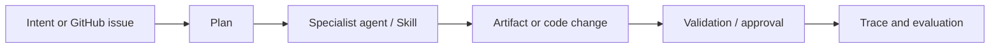

# NOVA | Engineering case study

> **Project status:** public beta. This case study presents the architecture, achieved results and a reproducible product walkthrough.

## The problem

Teams need to turn vague intents or GitHub issues into reproducible product and engineering work without losing context, approvals or auditability.

## The solution

An AI product agent with versioned Skills, planning and specialist agents, artifact versioning, governed ORBIT retrieval, and FORGE capture/evaluation hooks.

## System flow

## What is available to inspect

[Current capabilities and deployment caveats](STATUS.md) · [Engineering workflow](ENGINEERING.md) · [Architecture](ARCHITECTURE.md) · [CI](https://github.com/yassineaqejjaj/NOVA/actions/workflows/ci.yml).

## A concrete, reproducible demo

Use the locally seeded demo and document a single product-management request, the plan, context selected by ORBIT, the structured artifact, the approval gate, and the trace outcome. For engineering, use the already documented GitHub issue → draft pull request flow; do not auto-merge or publish external code without review.

## Achieved results

### NOVA Suite

| Indicator | Achieved result |
|---|---:|
| Deployed users | 800 |
| Task success rate | 92% |
| Task execution time reduction | −42% |
| D7 user retention | 23% |
| Technical execution success | 99.3% |
| Team members | 15 |

### Nova Agents

| Indicator | Achieved result |
|---|---:|
| Task completion rate | 86% |
| Agent coordination success | 92% |
| Deliverables accepted without major revision | 81% |
| Median task execution time | 28 s |

_Calculation method, scope and measurement period available on request._

NOVA Suite task success and Nova Agents task completion are different indicators. The 92% suite task success rate, 86% agent task completion rate and 92% agent coordination success rate describe their respective scopes.

## Measurement context

For a repeated evaluation, retain the task set, human-reviewed acceptance criteria, agent and model versions, time-to-completion baseline, execution traces and review decisions.

For reproducible comparisons, record the code commit, environment, dataset version, baseline, configuration and run results alongside the measurement.

## Demo scope and deployment

The public demo illustrates the workflow. Feature availability depends on the deployed version and configuration; consult the [status matrix](STATUS.md) for implementation, testing and deployment details.

## Five-minute recorded walkthrough

1. **0:00–0:30 — Context.** Explain the user problem and intended scope.
2. **0:30–1:15 — Architecture.** Walk through the principal services and what each owns.
3. **1:15–3:15 — Workflow.** Run the concrete synthetic demo above, showing actual UI and results.
4. **3:15–4:15 — Evidence.** Show relevant trace, test, or comparison; distinguish mock and real providers.
5. **4:15–5:00 — Limits.** Name known constraints and the next experiment.

**Recording checklist:** no live secrets, tokens, proprietary client data, personal health data or real student data; visually label synthetic content; keep a link to the exact code commit and test run used.

---

[Back to repository](../README.md)

